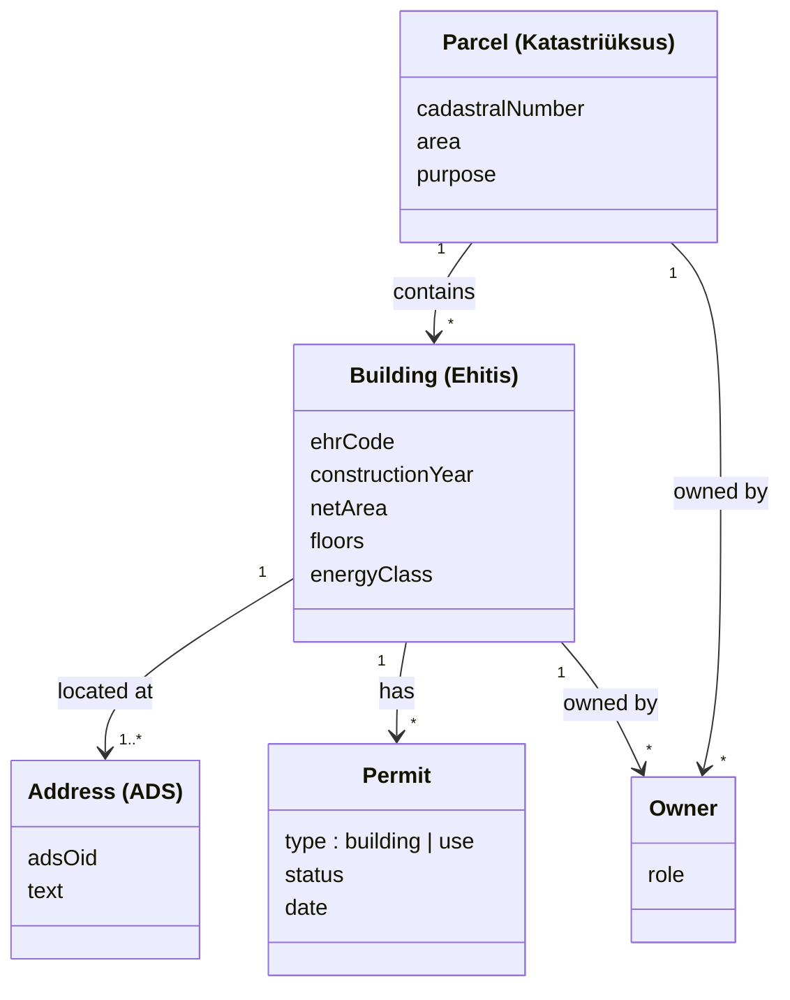

# Business model

Estonian legal terms are first-class. INSPIRE / LADM names are aliases.

| Concept | Alias (INSPIRE / LADM) | Note |
|---|---|---|
| Building | `bu-core2d:Building` | *ehitis* covers building **and** structure |
| Parcel | `cp:CadastralParcel` / `LA_Parcel` | |
| Owner | `LA_Party` / `LA_RRR` | personal data: service layer only |
| Permit | — | *ehitusluba* ≠ *kasutusluba* |

> Draft. To be validated against the real EHR data model.
