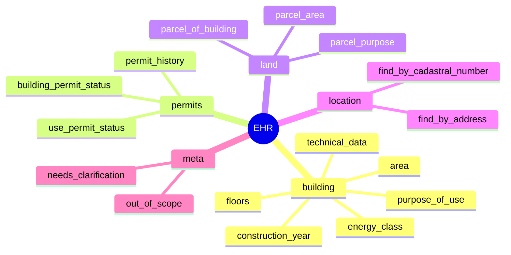

# Intent catalog

The **closed set**. Anything else is `out_of_scope`.

- ID format: `ehr.<group>.<intent>`, e.g. `ehr.permits.use_permit_status`.
- Same IDs in training data, mapping and logs.
- Draft list. Final set comes from the real EHR services.
