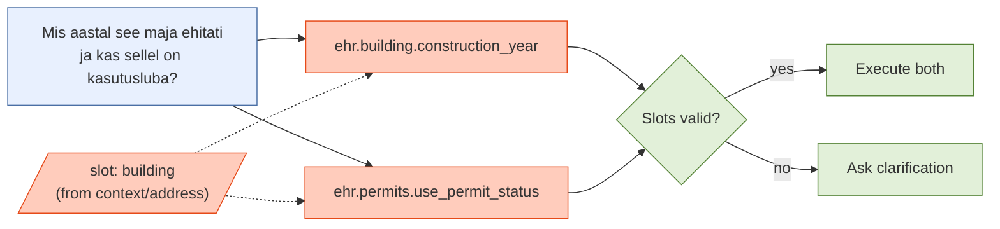

# Multi-intent & slots



Output shape:

```json
{"intents":[
  {"id":"ehr.building.construction_year","slots":{"building":"ref:ctx"}},
  {"id":"ehr.permits.use_permit_status","slots":{"building":"ref:ctx"}}
]}
```

| Slot | Formats |
|---|---|
| `ehr_code` | numeric |
| `cadastral_number` | `78401:101:0010` |
| `address` | free text → ADS lookup |
