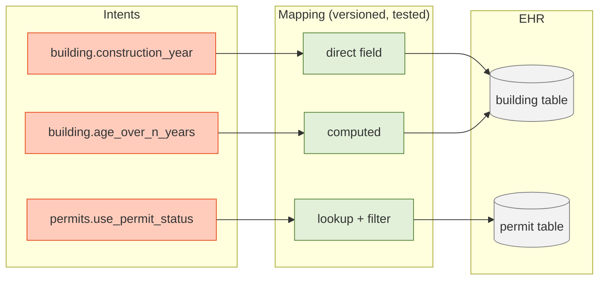

# Mapping to data

| Kind | Example | Mapping form |
|---|---|---|
| Direct | construction year | field |
| Lookup | use permit status | filtered query |
| Computed | older than 50 years? | function |

- Mapping is code: versioned, reviewed, tested against known buildings.
- Table and API names here are placeholders until the EHR schema is extracted.
