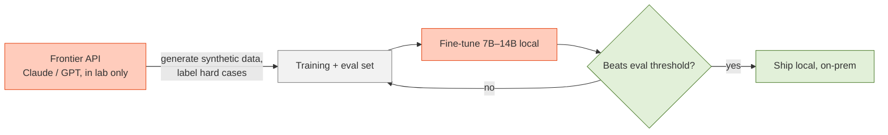

# Model choice: local vs frontier

Can a competent open-source local LLM match a frontier API (Claude, GPT, Gemini) for this use case? Split the question by task — the answer differs.

## By task

| Task | Local 7B–14B, fine-tuned | Frontier API, zero-shot | Winner |
|---|---|---|---|
| Intent detection (closed enum) | Near-ceiling with constrained decoding + fine-tune | Strong zero-shot | ≈ parity, lean local |
| Slot extraction (NER-like) | Strong on in-domain vocabulary | Strong broadly | ≈ parity |
| Confidence estimation | Direct access to token logprobs | Approximated via resampling | Local |
| Writing fluent Estonian | Good at EuroLLM-class, not great | Best in class | Frontier |
| Multi-step reasoning before intent choice | Weaker | Stronger | Frontier — but prefer "clarify" |
| Latency / cost / data residency | Low / none / on-prem | High / per-token / cloud | Local |

## Why intent detection is a local-friendly task

- **Closed output space.** Constrained decoding forces the intent into your enum. A 7B model physically cannot emit an invalid intent.
- **Depth over breadth.** Frontier models are broad; your catalog is narrow (≈50 intents). A fine-tune on ~500 hand-labelled + 5–10k synthetic examples typically closes the gap to within a point or two on domain-specific structured extraction.
- **Logprobs = confidence.** Owning the weights means owning the calibration signal. API models only let you approximate it by resampling.

## Estonian: reading vs writing

- **Reading** morphologically rich Estonian (NLU) is solved at the 7B–14B scale. Local models recognize Estonian fine.
- **Writing** register-correct, properly declined Estonian (NLG) is where frontier models still lead.
- In this architecture the LLM doesn't need to write — answers come from deterministic templates in Mapping, and clarification prompts can be templated per intent. The free-text surface you actually ship is tiny.

## Candidate open-weights models

| Model | Size | Why consider |
|---|---|---|
| **EuroLLM** | 9B | Trained on all EU languages incl. Estonian — likely best Estonian per parameter |
| **Qwen 2.5** | 7B / 14B | Strong structured-output and function-calling benchmarks |
| **Llama 3.3** | 8B / 70B | Strong general; Estonian competent at 70B |
| **Gemma 2 / 3** | 9B / 27B | Good on European languages |
| **Phi-4** | 14B | Strong reasoning in small footprint |

## Where the honest gap remains

- Zero-shot with no fine-tune: frontier wins.
- Very rare intents with few training examples: frontier wins.
- Ambiguous, hypothetical, or comparative queries: frontier wins — but you'd rather **clarify** than guess.

## Recipe that neutralizes the gap

1. Use a frontier model as an **oracle in the lab** — validate the catalog, generate synthetic data, label edge cases. Never in production.
2. Fine-tune an open 7B–14B model on that corpus.
3. Measure on the hand-written eval set.
4. Ship when the local model beats the **clarification threshold** on the eval, not when it matches the frontier zero-shot.

The deterministic mapping layer is the real equalizer: the LLM's worst remaining failure mode is "ask the user to clarify", not "produce a wrong answer." That tolerance budget is what makes local-first realistic here.
