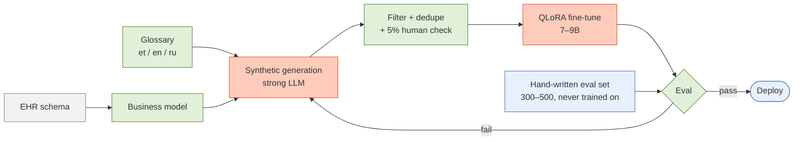

# Training pipeline

- Variation axes: persona, register, language, typos, slot style.
- Multi-intent examples are composed programmatically, then rephrased naturally.
- Include hard negatives and `out_of_scope`.
