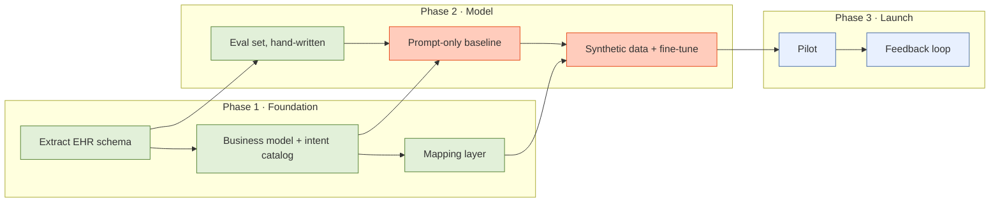

# Rollout

- **Foundation** has to land first: schema → catalog → mapping. Without it there is nothing to validate against or map to.
- **Model** work starts in parallel the moment the schema exists: eval set first (so quality has a ruler), then prompt baseline, then fine-tuning once synthetic data can be generated against the catalog.
- **Launch** is gated on a model that beats the eval threshold; feedback loop runs continuously after pilot opens.

> Ordering is a commitment; pace is not. Each phase ends when its exit criteria are met, not when a clock runs out.
